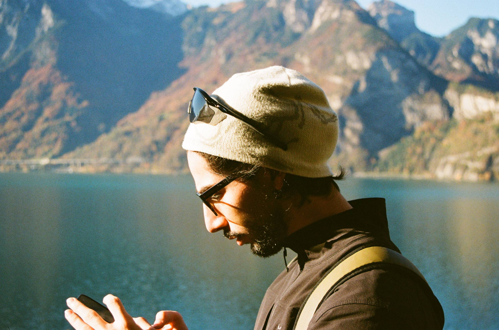

  

    
Intelligent Systems

    <h1>Kasra Malihi</h1>
  

  

    
I’m a computer science MSc student at the University of Copenhagen, currently on exchange at ETH Zurich.

    
At ETH’s <a href="https://las.inf.ethz.ch/">Learning and Adaptive Systems Group (LAS)</a>, I study uncertainty-aware reinforcement learning for post-training large language models, with a focus on <a href="https://proceedings.mlr.press/v306/hubotter26a.html">Self-Distillation Policy Optimization (SDPO)</a>.

    

      <a href="mailto:kasramalihi@gmail.com">Email ↗</a>
      <a href="https://github.com/kasramalih">GitHub ↗</a>
      <button class="bio-toggle" type="button" aria-expanded="false" aria-controls="biography">More about me +</button>
    

    

      
My research in Copenhagen included certified machine learning with prof. Amartya Sanyal and pixel language models with prof. Desmond Elliott.

      
I’m interested in how much more we can learn from the data we have already seen via post-training. In particular, I want to understand how reinforcement learning and better reward models can improve reasoning. Can we go beyond pass@k for any arbitrary high k?

      
Before Copenhagen, I earned my BSc in Computer Engineering at Sharif University of Technology. I ranked <strong>6th internationally</strong> in the university entrance exam. Outside of research, I like reading about mathematical finance, playing chess ♟️, and running/hiking ⛰️.

    

  

