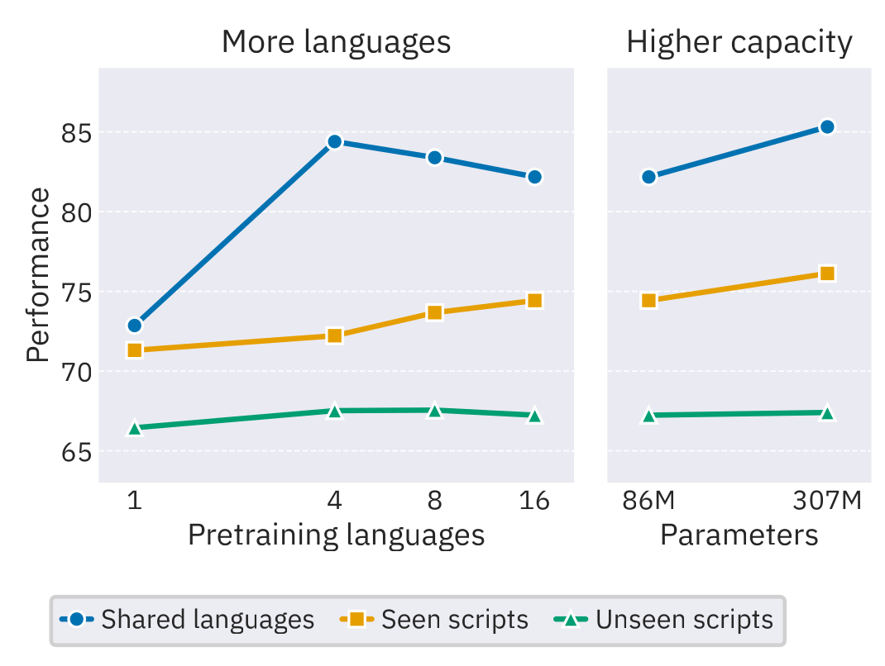
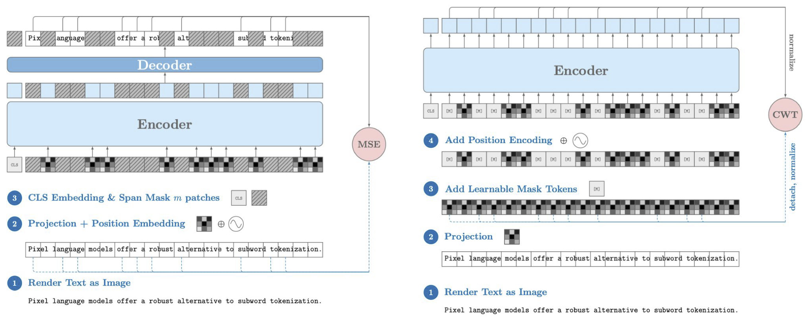
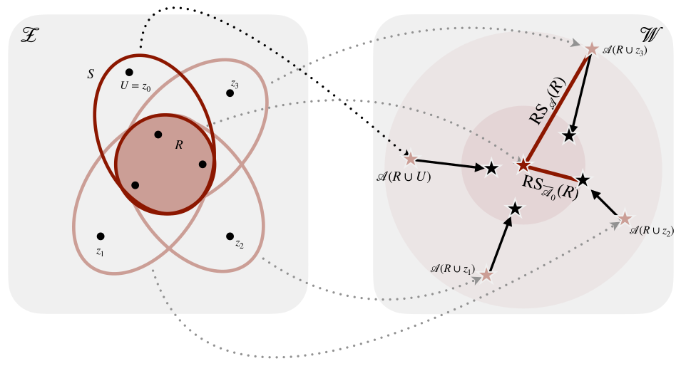
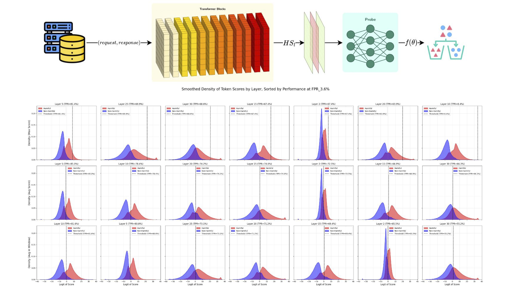

<h2>Research</h2>

<article class="paper">
  
  

    
<time datetime="2026-10">October 2026</time>arXiv preprint

    <h3><a href="https://arxiv.org/abs/2610.29681">Scaling Multilingual Pretraining of Pixel Language Models</a></h3>
    
Ilker Kesen, Jenny Kunz, <strong>Kasra Malihi</strong>, Desmond Elliott

    <ul class="paper-topics" aria-label="Research topics">
      <li>Pixel language models</li>
      <li>Multilingual pretraining</li>
    </ul>
    

      

        
Abstract

        
Pixel language models process text as rendered images instead of a finite vocabulary, which gives them strong cross-lingual transfer abilities. However, not much is known about how these abilities are influenced by larger-scale pretraining. In this paper, we train a family of MPIXEL models along three axes of variation: more languages, more scripts, and larger model capacity under fixed per-language compute. In evaluations on five tasks covering 83 languages, we find that scaling acts locally: each axis improves the added languages and scripts, while increased capacity mitigates the curse of multilinguality from pretraining on more languages. Transfer to unseen scripts improves with multilingual pretraining, but does not further improve with scaling. On typologically distant low-resource languages, our models outperform subword and character-level baselines across many writing systems. We also show that larger pixel models reserve more layers for visual processing, and that cross-lingual alignment weakens as more languages are added. Overall, our findings characterize how multilingual scaling improves pixel language models.

        
<a href="https://arxiv.org/abs/2610.29681">Abstract and Figure 1</a> · <a rel="license" href="https://creativecommons.org/licenses/by/4.0/">CC BY 4.0</a>

      

      <a href="https://arxiv.org/pdf/2610.29681">PDF ↗</a>
    

  

</article>

<article class="paper">
  
  

    
2026Preprint

    <h3><a href="https://drive.google.com/file/d/1utY01Cq0Kl6eUfCEWQ4XWtMSmbHglR7q/view?usp=share_link">Headless PIXEL language modeling</a></h3>
    
<strong>Kasra Malihi</strong>

    <ul class="paper-topics" aria-label="Research topics">
      <li>Language model pretraining</li>
      <li>Tokenization-free NLP</li>
    </ul>
    

      
Abstract

      
 Pixel-based language models offer a robust alternative to subword tokenization by processing text directly as rendered images, effectively bypassing vocabulary bottlenecks and multilingual constraints. However, most of the existing visual language pre-training methods rely heavily on Masked Autoencoder (MAE) architectures with Mean Squared Error (MSE) objective. We argue that exact pixel reconstruction does not necessarily correlate with effective language modeling; forcing a model to perfectly redraw text discards the semantic uncertainty that is fundamental to language understanding. Furthermore, MSE exhibits severe mathematical and structural limitations in this domain. It is highly brittle to minor spatial translations, where even a one-pixel shift yields massive error penalties. Unlike standard computer vision models that mitigate such sensitivities through spatial augmentations (e.g., cropping and flipping), rendered text cannot be naturally subjected to these perturbations without destroying readability. To address these vulnerabilities, we explore a self-supervised contrastive approach for pixel-based language modeling. Building upon the Headless Language Model framework, we transition away from the MSE reconstruction paradigm in favor of optimizing the Vision Transformer encoder directly via Contrastive Weight Tying (CWT). Empirical evaluations demonstrate that our encoder-only architecture achieves 74.8% downstream accuracy, while the variant retaining the decoder yields 75.8%.

    

  

</article>

<article class="paper">
  
  

    
2026<a href="https://tpdp.journalprivacyconfidentiality.org">TPDP 2026</a>ALT 2026 under review

    <h3><a href="https://arxiv.org/abs/2603.03172">Less Noise, Same Certificate: Retain Sensitivity for Unlearning</a></h3>
    
Carolin Heinzler, <strong>Kasra Malihi</strong>, Amartya Sanyal

    <ul class="paper-topics" aria-label="Research topics">
      <li>Unlearning</li>
      <li>Certified machine learning</li>
    </ul>
    

      

        
Abstract

        
Certified machine unlearning aims to provably remove the influence of a deletion set <em>U</em> from a model trained on a dataset <em>S</em>, by producing an unlearned output that is statistically indistinguishable from retraining on the retain set <em>R := S \ U</em>. Many existing certified unlearning methods adapt techniques from Differential Privacy (DP) and add noise calibrated to global sensitivity, i.e., the worst-case output change over all adjacent datasets. We show that this DP-style calibration is often overly conservative for unlearning, based on a key observation: certified unlearning, by definition, does not require protecting the privacy of the retained data <em>R</em>. Motivated by this distinction, we define retain sensitivity as the worst-case output change over deletions <em>U</em> while keeping <em>R</em> fixed. While insufficient for DP, retain sensitivity is exactly sufficient for unlearning, allowing for the same certificates with less noise. We validate these reductions in noise theoretically and empirically across several problems, including the weight of minimum spanning trees, PCA, and ERM. Finally, we refine the analysis of two widely used certified unlearning algorithms through the lens of retain sensitivity, leveraging the regularity induced by <em>R</em> to further reduce noise and improve utility.

      

      <a href="https://caroheinz.github.io/slides/Retain%20Sensi/Retain.pdf">Slides ↗</a>
    

  

</article>

<article class="paper">
  

  

    
2025BSc thesis

    <h3>Hidden State Analysis for LLM Adversarial Defense: A Layer-wise Approach to Representation Engineering</h3>
    
<strong>Kasra Malihi</strong>, Mahdieh Soleymani Baghshah

    <ul class="paper-topics" aria-label="Research topics">
      <li>LLM safety alignment</li>
    </ul>
    

      
Abstract

      
Large Language Models have emerged as powerful tools, revolutionizing various domains with their advanced Natural Language Processing capabilities. Their increasing integration into critical applications, however, necessitates robust safety mechanisms to ensure their reliable and ethical deployment.
            Despite their transformative potential, LLMs are highly susceptible to a growing array of Adversarial Attacks, including sophisticated Jailbreaks, prompt injection, and data poisoning. This dynamic and evolving threat landscape poses a significant challenge to maintaining the integrity, trustworthiness, and beneficial operation of these models in real-world environments.
            This thesis aims to address the critical problem of enhancing LLM safety and robustness against these persistent adversarial threats. Our primary goal is to develop and understand a novel defense mechanism by focusing on the potential of Representation Learning within LLMs.
            In this research, the proposed method of layer-wise representation reading and engineering was presented, consisting of two stages: probing the model’s layers using a neural network and engineering promising layers through parameter-efficient fine-tuning. The proposed method was evaluated on the HarmBench dataset. Results showed that the proposed method achieved an accuracy of 84.98%, outperforming reference methods.

    

  

</article>
